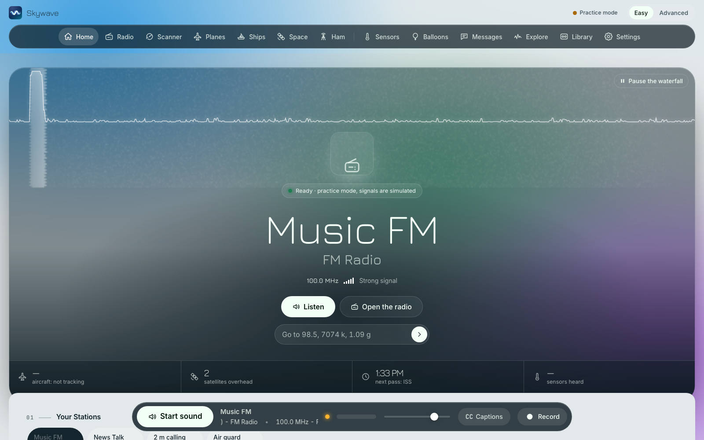
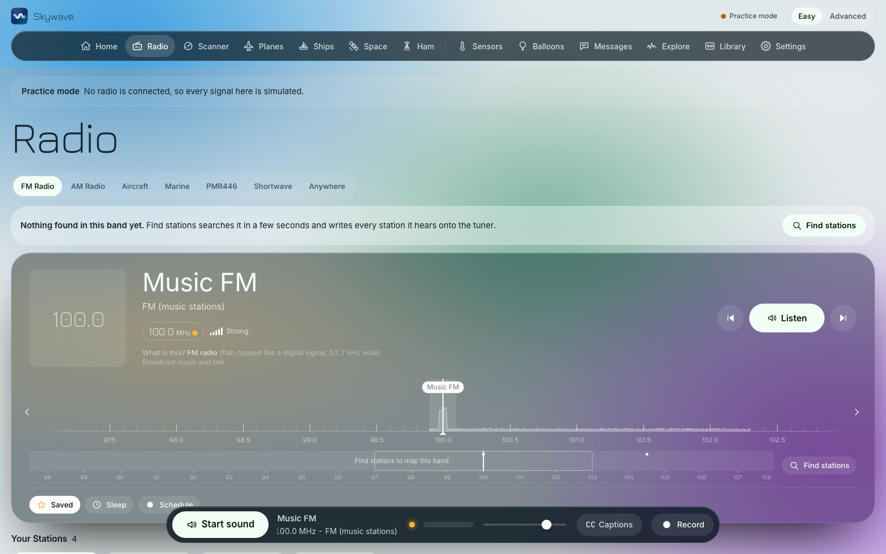
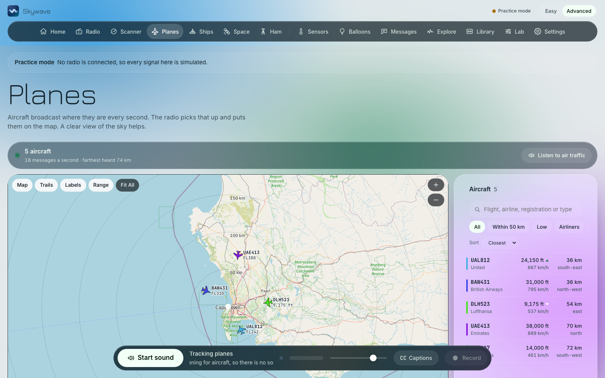
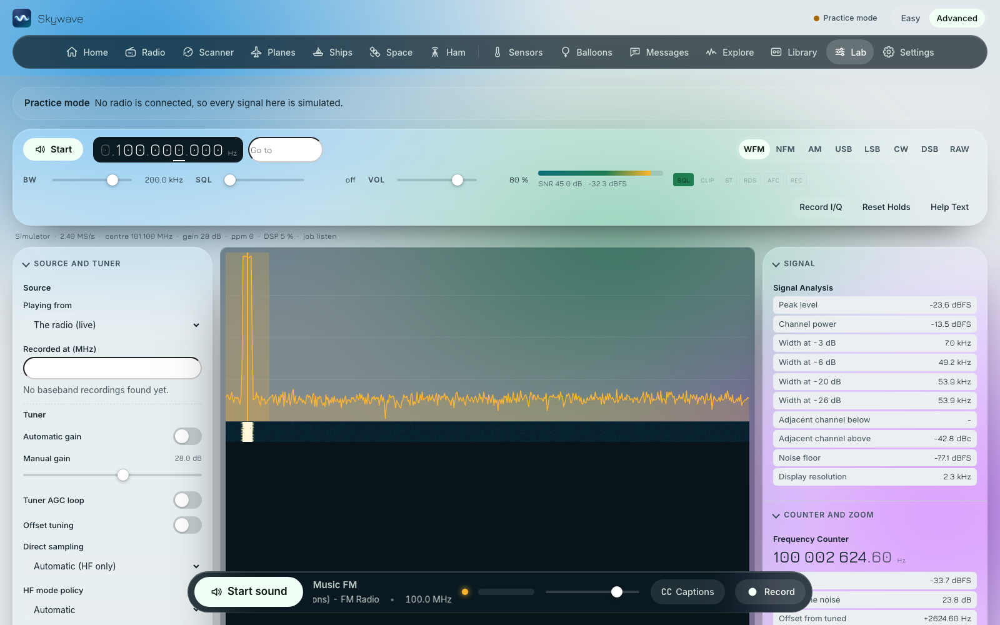
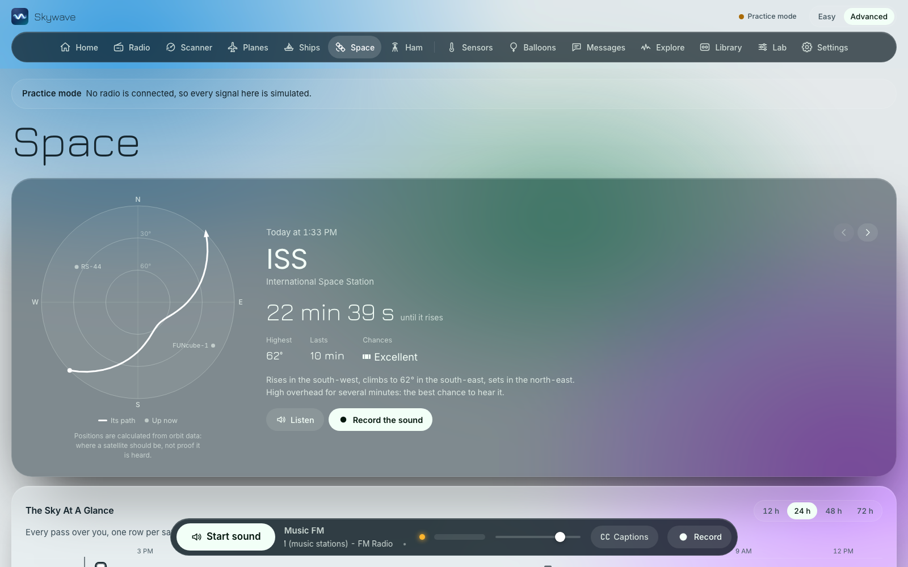
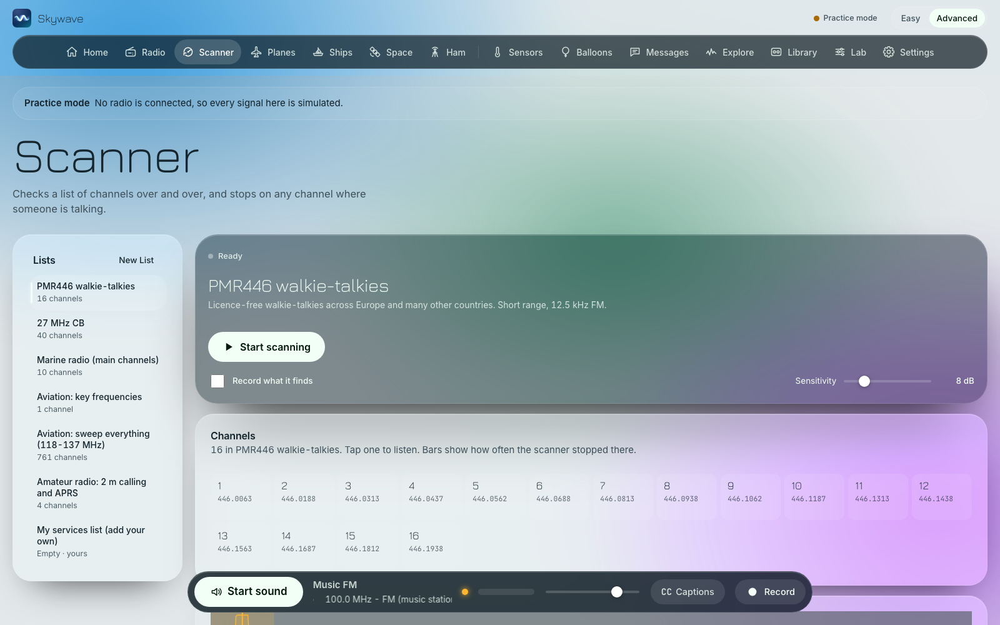
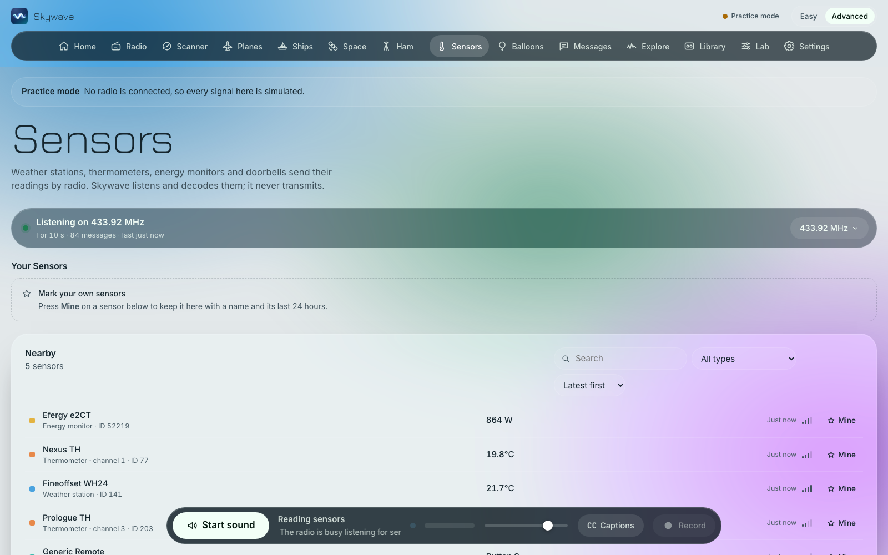
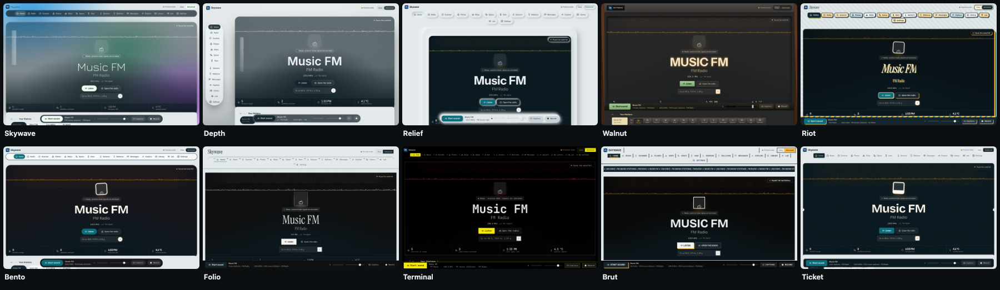
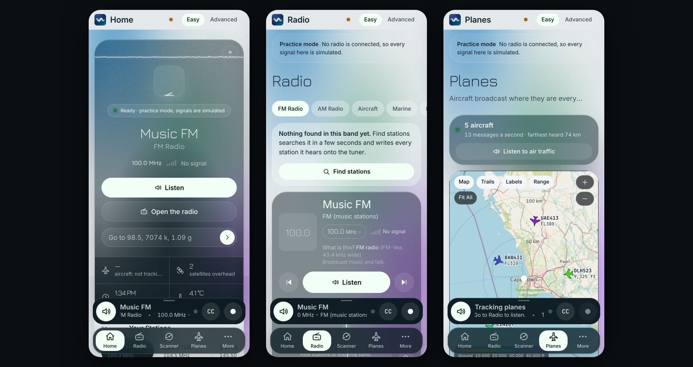

# Skywave

A self-hosted web app for an RTL-SDR USB radio dongle. Listen to FM, AM, air-band and marine radio, follow aircraft and
ships on a live map, record satellite passes and weather pictures, read wireless sensors, pagers and aircraft messages,
scan channels and dig into signals in a full receiver lab. One page that works on desktop and phone, in 96 languages,
with ten distinct looks. Channel lists, band plans and units follow the country you choose.



## What it does

| | |
|---|---|
| **Radio** | FM with stereo, RDS station names and song text, cover art and a list of songs heard; AM, air band, marine, PMR and shortwave; your saved stations one tap away. |
| **Planes** | Aircraft (ADS-B) on a live map with their registration, type, operator, photo and route, the airport and terminal at each end, how far along the flight is and when it lands. |
| **Ships** | Vessels nearby from their AIS beacons. |
| **Space** | Satellite passes with where to point the antenna, automatic recording, and weather pictures from Meteor satellites and SSTV pictures from the space station. |
| **Scanner** | Steps through lists of channels and stops when someone talks. Lists for your country are built in; make your own. |
| **Sensors** | Weather stations, thermometers, energy monitors and more near you (rtl_433), with history, and an optional link to Home Assistant over MQTT. |
| **Messages** | Pager messages and aircraft messages (ACARS), shown on the page only. |
| **Ham** | Amateur bands, APRS and signal reports. |
| **Captions** | Spoken channels written down as they are said. |
| **Lab** | A full receiver console on one screen: tuning by digit, every demodulator, noise and audio setting, a frequency counter to a hundredth of a hertz, I/Q scope, audio analyser, spectrum integrator, signal logger and level calibration. |
| **Library** | Recordings, pictures and transcripts, with a player. |

<table>
<tr><td></td><td></td></tr>
<tr><td></td><td></td></tr>
<tr><td></td><td></td></tr>
</table>

### Ten styles, each its own layout

Skywave, Depth, Relief, Walnut, Riot, Bento, Folio, Terminal, Brut and Ticket change the shape of everything (frames,
type, dials, motion), not just the colours. 28 colour palettes sit on top, or make your own; text contrast is checked
automatically. Motion follows your system's reduced-motion setting, and can be turned off in Settings.



### On a phone



## Quick start

You need Docker, an RTL-SDR dongle (an RTL-SDR Blog V4 is recommended) and an antenna.

**Linux and Raspberry Pi**
```bash
docker compose up -d --build
```
Open `http://localhost:8073`, or `http://<that computer's address>:8073` from another device.
If the dongle is reported busy, blacklist the TV driver and replug it:
```bash
echo 'blacklist dvb_usb_rtl28xxu' | sudo tee /etc/modprobe.d/blacklist-rtl.conf
```

**macOS and Windows (Docker Desktop):** containers there cannot see USB, so serve the dongle from the host and connect
over the network:
1. Install the RTL-SDR drivers (Windows: the RTL-SDR Blog V4 guide and Zadig; macOS: `brew install librtlsdr`).
2. Run `rtl_tcp -a 127.0.0.1` and leave it running.
3. `docker compose -f docker-compose.desktop.yml up -d --build`, then open `http://localhost:8073`.

Sensors and utility meters are read over that connection too.

**Without a dongle:** set `SIM: "1"` in the compose file to use the built-in simulator, with stations, aircraft and
satellite signals to try everything.

The first visit runs a short setup: language, country, look, location (type a town, suburb or postcode) and units.

## Configuration

Set under `environment:` in the compose file. Everything else is in Settings.

| Variable | What it does |
|---|---|
| `AUTH_USER` / `AUTH_PASS` | Password-protect the page (set both). |
| `ALLOWED_HOSTS` | With no password set, Skywave only answers to IP addresses, `localhost`, single-word names and `.local`, `.lan`, `.home.arpa` and `.internal` names. List any other names you open it by here, comma-separated (for example a reverse-proxy name). |
| `SIM` | `1` uses the simulator instead of a dongle. |
| `RTL_TCP` | `host:port` of an `rtl_tcp` server to use instead of USB (sensors and meters use it too). |
| `LAT`, `LON`, `ALT` | Fix the location. |
| `TZ` | Container time zone. |
| `PORT` | Web port (default `8073`). |
| `SAMPLE_RATE`, `GAIN_DB`, `PPM`, `BIAS_T`, `HF_MODE`, `DEEMPH_US` | Fix a tuner setting so it cannot be changed from the page. |

Data lives in `./data`: settings, favourites, scanner lists, recordings, pictures, cover art and orbit data.
Optional utility-meter support: `docker compose build --build-arg WITH_RTLAMR=1`.

Skywave serves plain http on your own network. To reach it from outside your home, put it behind a reverse proxy with a
real certificate, or use a VPN, and set a password.

## What leaves your machine

Only these requests go out, each when the feature that needs it is used:

- orbit data from CelesTrak and SatNOGS
- place search from Open-Meteo, OpenStreetMap Nominatim and Photon (only the words you type; suggestions while you
  type go to Open-Meteo and Photon only, after a short pause)
- aircraft details and routes from adsbdb, adsb.lol, adsb.im and hexdb.io (the aircraft's address, callsign and
  position, or your receiver's position rounded to about 10 km)
- the track flown so far by the plane you choose, from adsb.lol (aircraft address only)
- the list of airports from OurAirports, once a month (nothing is sent)
- maps of an airport's terminals from OpenStreetMap's Overpass API (only the airport's position), once a month per
  airport
- cover art from Apple, Deezer, MusicBrainz and the Cover Art Archive (only the song text and your country)
- map tiles from OpenStreetMap

Pages send no referrer, except map tiles, which carry this Skywave's address only (no path), because the tile servers
require it. See [SECURITY.md](SECURITY.md) for how Skywave protects itself and how to report a problem.

## Tests

No hardware needed; they use the simulator and stand-ins for outside services.
```bash
for t in tests/test_*.py; do python3 -W ignore "$t" || break; done
node tests/player_hiccups.js; node tests/player_retune.js
NODE_PATH=$(npm root -g) node tests/pw_home.js           # browser tests need Playwright and Chromium
```

The screenshots above are made with `NODE_PATH=$(npm root -g) node tools/screenshots.js` (written to
`docs/screenshots`).

## Security and the law

On Linux the container runs privileged to reach USB, so run it on a network you trust and set a password if others can
reach it. Radio laws differ between countries; what you receive, record and transcribe is your responsibility. Pager
messages are shown on the page only and never written to disk.

## Licence and credits

MIT licence (see `LICENSE`). Skywave runs these open-source programs as separate processes, under their own licences:
the RTL-SDR drivers, rtl_433, multimon-ng, ffmpeg, meteor_demod and meteor_decode, rtlamr, faster-whisper and the
optional `sstv` package. Bundled in the page: GSAP 3.15.1 by GreenSock (GSAP Standard "no charge" licence) and Lenis
1.3.27 by darkroom.engineering (MIT). Bundled fonts are under the SIL Open Font License, with licence files alongside:
Atkinson Hyperlegible, B612 Mono, Bricolage Grotesque, Geist Mono, Instrument Sans, Instrument Serif, Inter, JetBrains
Mono, Jura and Poiret One. Data: OurAirports (public domain), OpenStreetMap (© OpenStreetMap contributors, ODbL),
aircraft and route data from adsbdb, adsb.lol, adsb.im and hexdb.io, orbit data from CelesTrak and SatNOGS.
